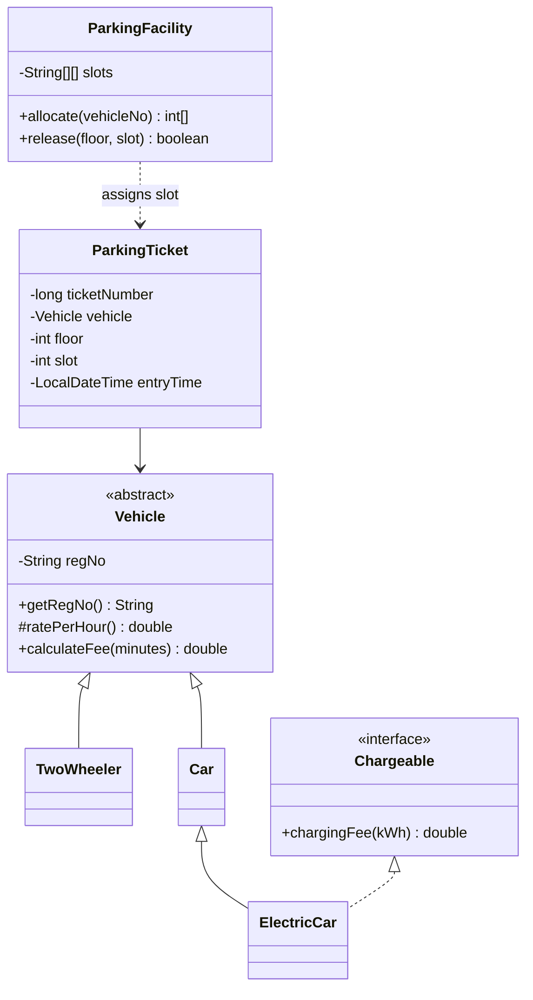

# Assignment Report: Campus Smart-Parking System

**Student:** Yashaswini  
**Register No:** 192425250  
**Runtime used:** Java 27.0.0, Windows PowerShell

## Task 01: Constructor Chaining

**Discussion:** A three-level constructor chain shows base-to-derived execution: `VehicleBase`, `CarBase`, then `ElectricCarDemo`. Each subclass constructor runs only after its superclass constructor returns.

**Alternative and complexity:** Constructor chaining is preferable to manually initializing inherited state in each subclass. Construction is O(1) time and O(1) auxiliary space for this fixed hierarchy.

**Evidence:** The captured trace is in `Task01/output.txt`; source is `Task01/ConstructorChainDemo.java`.

## Task 02: Static Ticket Counter

**Discussion:** `TicketCounter.nextNumber` is shared by all instances; each ticket stores its assigned number separately. The demo creates 1, 2 and leaves 3 as the next number.

**Alternative and complexity:** A synchronized or atomic counter is needed if multiple threads issue IDs. The simple static integer increment is O(1) time and O(1) shared space.

**Evidence:** `Task02/output.txt`.

## Task 03: Jagged Parking Facility

**Discussion:** A `String[][]` stores one row per floor, allowing unequal floor capacities. Allocation scans in floor-major order, returns the first vacant `{floor, slot}`, and returns `null` when full. Release rejects out-of-range and already-free coordinates. The supplied main produces the exact required output.

**Allocation pseudocode:**

```text
allocate(vehicleNo):
    for each floor from 0 to floorCount - 1:
        for each slot from 0 to slotsOnFloor - 1:
            if slots[floor][slot] is empty:
                slots[floor][slot] = vehicleNo
                return {floor, slot}
    return null
```

**Fee computation pseudocode:** The later fee demo uses whole billed hours; an incomplete hour rounds up. Charging energy is a separate additive fee.

```text
calculateFee(minutes, hourlyRate):
    reject minutes < 0
    hours = (minutes + 59) / 60 using integer arithmetic
    return hours * hourlyRate

calculateVehicleFee(vehicle, minutes, kWh):
    fee = calculateFee(minutes, vehicle hourly rate)
    if vehicle supports charging:
        fee = fee + vehicle.chargingFee(kWh)
    return fee
```

**Alternative and complexity:** A boolean bitmap could store occupancy when vehicle identities are maintained elsewhere. The current representation stores the registration directly and uses O(S) space for S slots. Allocation is O(S) worst case and O(1) best case; release is O(1).

**Evidence:** `Task03/output.txt` exactly matches the specified six lines.

## Task 04: `toString`, `equals`, and `hashCode`

**Discussion:** `VehicleRecord` is immutable. Equality compares registration and type, and equal values produce equal hash codes, satisfying the Java object contract.

**Alternative and complexity:** A Java record could generate value methods automatically. The explicit class makes the implementation visible for this exercise. Rendering, equality, and hashing are O(1) for the short fields used here.

**Evidence:** `Task04/output.txt`.

## Task 05: Access Modifiers

**Discussion:** The demo exercises public, protected, package-private, and private members. The subclass reads the protected rate; registration is private and accessed through a public getter.

**Alternative and complexity:** Package-level interfaces can expose a smaller surface than public getters when only a package needs access. Each access operation is O(1); storage is O(1).

**Evidence:** `Task05/output.txt`.

## Task 06: UML and Constructor Order

**Discussion:** The sample hierarchy separates the abstract vehicle contract from concrete vehicle types; a facility assigns coordinates and a ticket binds a vehicle, location, and entry time. `ElectricCar` specializes `Car` and adds the charging capability.



**Constructor-order trace:** `new ModelElectricCar("TN06EV0006")` executes `ModelVehicle(regNo)`, then `ModelCar(regNo)`, then `ModelElectricCar(regNo)`. The real trace is in `Task06/output.txt`.

**Alternative and complexity:** Composition could model a vehicle's charging capability instead of inheritance, allowing charging to be attached independently of vehicle kind. The displayed object construction is O(1) time and space.

**Evidence:** `Task06/ConstructorOrderDemo.java` and its captured trace.

## Task 07: Parallel Arrays Versus Objects

**Discussion:** Both representations scan 100,000 values for 20 rounds and produce checksum 29,998,500.

**Alternative and complexity:** Parallel arrays can improve packed data locality but make related state easier to misalign; objects group fields and behavior but add per-object overhead. Both have O(N) space and O(N) time per scan. In the captured run, parallel arrays took **7,410,500 ns** and objects took **6,358,600 ns**. This is one measurement, not a statistically controlled benchmark; JVM warmup, garbage collection, and system load can change the result.

**Evidence:** Actual output in `Task07/output.txt`.

## Task 08: Polymorphic Fee Calculation

**Discussion:** `Vehicle.calculateFee` invokes the subclass's `ratePerHour` dynamically. The `Chargeable` pattern match adds the EV charge without a type cast. Equality is by registration, so the final comparison between a `Car` and `ElectricCar` returns true.

**Dynamic-dispatch trace:**

1. The `Vehicle[]` loop retrieves a `TwoWheeler`, `Car`, or `ElectricCar` reference.
2. `calculateFee(130)` computes three billed hours.
3. The virtual call to `ratePerHour()` resolves to 10 for `TwoWheeler`, or 30 for `Car` and `ElectricCar`.
4. Runtime type detection finds only the `ElectricCar` implements `Chargeable`; 10 kWh adds Rs 120.
5. The output is Rs 30.0, Rs 90.0, and Rs 210.0 respectively.

**Alternative and complexity:** A pricing strategy object could replace the overridden rate method for runtime-configurable tariffs. Each fee calculation is O(1) time and O(1) extra space.

**Evidence:** `Task08/output.txt` matches the required output exactly.

## Task 09: ArrayList Versus HashMap Lookup

**Discussion:** The benchmark performs 2,000 lookups for the last key among 50,000 entries and checks that both implementations return the same accumulated checksum, 99,998,000.

**Alternative and complexity:** ArrayList supports ordered storage and O(N) search. HashMap offers expected O(1) lookup with O(N) storage, subject to hash distribution. In this measured run, ArrayList took **547,235,600 ns** and HashMap took **1,211,400 ns**. These single-run timings are machine- and JVM-dependent.

**Evidence:** Actual checksum and timing are in `Task09/output.txt`.

## Task 10: Free-Slot Stack

**Discussion:** A `Deque<Integer>` stack allocates and releases a known slot in O(1) time. The demo shows initial allocation, release, and reuse.

**Alternative and complexity:** A floor-major scan guarantees the first free slot and naturally matches Task03's requirement; the stack is faster for arbitrary free-slot reuse but requires a correctly maintained free list. Stack storage is O(S).

**Evidence:** `Task10/output.txt`.

## Task 11: Complete Packaged System

**Discussion:** The implementation separates model, service, and console application packages. Vehicles validate immutable registration numbers. `ParkingFacility` supports the standard 1x20, 3x50, and 5x100 capacities. `ParkingTicket` has chained overloads and a copy constructor that receives a fresh static ID; equality and hashing use ticket ID. `ParkingService` stores active tickets in a `HashMap` keyed by registration. Monthly passes are owner-, vehicle-type-, and date-validated. Fee arithmetic uses integer ceiling hours, vehicle-specific rates, a per-day cap, and an EV charging add-on. The menu supports park, exit, status, and quit.

**Alternative and complexity:** A priority queue or free-slot stack can make allocation O(log S) or O(1), respectively, but requires additional bookkeeping. The simple facility scan is O(S) worst case and O(S) space; release is O(1). HashMap active-ticket operations are expected O(1) and use O(V) space for V active vehicles. Fee calculation is O(1).

**Test table:** `PASS` means the executable assertion succeeded.

| Test | Result | Expected/observed |
|---|---|---|
| Two-wheeler, 60 min | PASS | Rs 10 |
| Car, 120 min | PASS | Rs 60 |
| EV, 60 min plus 5 kWh | PASS | Rs 90 |
| Zero minutes | PASS | Rs 0 |
| Exactly 60 minutes | PASS | Rs 30 |
| Daily maximum at 24 hours | PASS | Rs 100 |
| LocalTime across midnight | PASS | 60 min; Rs 30 |
| Last free slot | PASS | slot 0:0 allocated |
| Full facility | PASS | returns null |
| Duplicate active registration | PASS | rejected |
| Invalid slot indexes | PASS | rejected |
| Standard facility sizes | PASS | 20, 150, 500 slots |
| Negative duration | PASS | rejected |
| Unknown vehicle type | PASS | rejected |
| Valid monthly pass | PASS | Rs 0 |
| Reissued ticket identity | PASS | fresh ticket number |
| Five-vehicle hand total | PASS | Rs 380 |

**Hand calculation:** Five cars parked for 1, 2, 3, 4, and 5 billed hours cost Rs 30 + Rs 60 + Rs 90 + Rs 100 + Rs 100 (daily cap applied) = **Rs 380**. The test runner calculates the same total. Result: **17 passed, 0 failed**.

**Evidence:** `Task11/output.txt`; run the interactive version with `java -cp out parking.app.ParkingApp`.

## Task 12: Extended System (A/B/C/D)

### A. Baseline

Task12 begins as a copy of the Task11 package structure and retains existing vehicle behavior and tests where possible.

### B. Extensions

`EBike` receives a flat Rs 25 fee. `DeliveryVan` receives twice the car's hourly rate for billed hours beginning from 09:00 through 16:59. An explicit `PricingRule` interface dispatches standard, van, and EBike calculations. The new `Pass` interface supports the existing `MonthlyPass` and visitor `OneDayPass`. The menu facility has five floors of 30, 40, 50, 20, and 60 slots; standard 1/3/5-floor layouts remain available.

### C. Validation and complexity

The 22-check runner covers both new vehicle categories, van daytime and nighttime rates, visitor passes, the custom 200-slot facility, inherited standard capacities, and Task11 boundary cases. Standard and flat-fee calculation is O(1). Delivery-van calculation examines H billed hours, O(H). Facility scan is O(S) worst case; active-registration lookup is expected O(1).

### D. Change count and evidence

**Seven existing classes modified:** `ParkingFacility`, `MonthlyPass`, `ParkingTicket`, `FeeCalculator`, `ParkingService`, `ParkingApp`, and `TestRunner`.  
**Eight new types:** `EBike`, `DeliveryVan`, `Pass`, `OneDayPass`, `PricingRule`, `StandardPricingRule`, `DeliveryVanPricingRule`, and `EBikePricingRule`. Existing `Vehicle`, `TwoWheeler`, `Car`, and `ElectricCar` implementations remain unchanged.  
**Result:** 22 passed, 0 failed; see `Task12/output.txt`.
